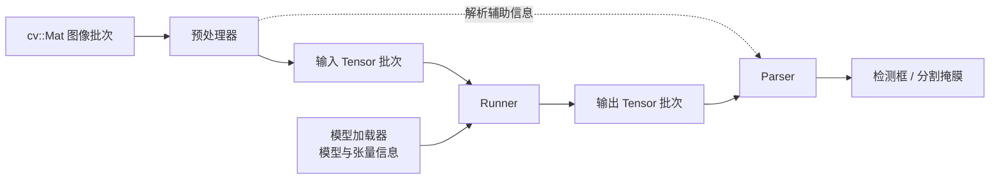

# dp 模块设计说明

## 1. 模块职责

`dp` 将深度学习视觉任务拆分为模型加载、图像预处理、模型推理和结果解析四个阶段，并通过模板组件组合成检测器或分割器。模块本身不绑定某一种模型格式或前后处理算法；当前仓库提供的完整实现是基于 ONNX Runtime 的 YOLOv8 检测和实例分割。



一次 `run` 调用按顺序执行：

1. 预处理器将图像批次转换为模型输入张量，并产生供解析阶段使用的辅助信息。
2. Runner 使用已加载的模型执行推理，返回输出张量。
3. Parser 根据输出张量、预处理辅助信息、类别数和阈值生成任务结果。

模型通过 `loadModel` 单独加载；加载时会查询并记录模型的输入、输出名称及形状。

## 2. 核心抽象

| 抽象 | 基类 / 接口 | 职责 |
|---|---|---|
| 模型加载器 | `ModelLoaderBase` | 加载模型、提供模型实例、查询输入和输出张量信息 |
| 预处理器 | `PreprocessBase` | 把图像批次转换为输入 `Tensor`，并输出解析辅助信息 |
| 运行器 | `RunnerBase` | 接收模型与输入张量，执行推理并返回输出张量 |
| 结果解析器 | `ParserBase` | 将模型输出转换为任务结果 |
| 流水线 | `_DPBase` | 保存上述组件与运行参数，并编排完整推理过程 |

这些基类使用 CRTP（Curiously Recurring Template Pattern）：派生组件实现对应的 `loadImpl`、`getImpl`、`getSizeImpl`、`preprocess`、`run` 或 `parse` 方法，基类通过统一调用入口转发。流水线以模板参数注入组件，因此可以替换模型后端、前后处理实现或任务结果类型。

`DPDetector` 和 `DPSegmentor` 是 `_DPBase` 的类型别名，分别将结果类型固定为 `DetectResArray` 和 `SegmentResArray`。

## 3. 数据结构与结果约定

- `TensorInfo` 保存张量名称和形状。模型形状中的 `-1` 表示动态维度。
- `Tensor` 将 `TensorInfo` 与承载数据的 `cv::Mat` 放在一起。
- `DetectResArray` 的结构为“图像批次 → 类别 → 检测结果”；每个 `DetectRes` 用平行的 `boxs`、`scores` 数组保存矩形框和分数。
- `SegmentResArray` 同样按“图像批次 → 类别”组织；每个 `SegmentRes` 的 `boxs`、`scores`、`masks` 按检测项对应。掩膜是 `CV_8UC1` 图像，尺寸对应其检测框区域。
- 结果框使用原始输入图像坐标。对于 LetterBox 预处理，解析器使用每张图像对应的变换参数反算坐标，并裁剪到原图范围。

类别下标与模型类别顺序一致。`classNum` 应与模型输出类别数一致；分数阈值和 NMS 阈值按类别下标配置。未提供的阈值项分别补为 `0.5` 和 `0.4`。

## 4. 当前默认实现

### 4.1 ONNX Runtime

`OnnxLoader` 负责创建 ONNX Runtime 会话、查询输入输出信息和配置执行设备；`OnnxRunner` 按模型输入输出名称运行会话。当前支持：

- CPU
- CUDA
- OpenVINO CPU

`OnnxLoader` 默认选择 CUDA。若所选执行提供器不可用或配置失败，代码会改用 CPU 会话配置；CPU 线程参数为 `0` 时按当前 CPU 线程数的一半设置。CUDA 设备 ID、CPU 并发数、OpenVINO 线程数和流数可通过加载器接口配置。成功附加执行提供器但后续会话创建失败时，加载过程仍可能报错，不应视作一定会自动回退。

当前 Runner 使用浮点张量，并要求输入张量数量与模型声明的输入数量一致。输入数据由 `cv::Mat` 承载；推理结果会复制到输出 `cv::Mat` 中。输入数量不匹配或推理异常时会记录错误并返回空张量结果。

### 4.2 LetterBox 预处理

`LetterBox` 负责缩放图像并填充到网络输入尺寸，同时保存 `[ratio_x, ratio_y, pad_x, pad_y]`，供解析器把坐标映射回原图。预处理参数通过模板参数固定，确保预处理器和解析器使用同一配置。

当前 `SimpleLetterBoxConfig` 的配置为：保持宽高比、不放大、不开启自动形状、stride 为 32、居中填充，并使用模型的第 0 个输入。`LetterBoxPreprocessor` 默认填充色为 `(114, 114, 114)`、缩放因子为 `1/255`、交换 R/B 通道；转换后的图像由 OpenCV `blobFromImages` 组装成批量张量。

对于动态尺寸输入，预处理器使用 `setDynamicInputSize` 指定的正宽高作为目标尺寸。固定输入尺寸则优先读取模型输入张量的空间维度。

### 4.3 YOLOv8 解析

- 检测解析器要求一个输出张量，形状约定为 `[batch, 4 + classNum, predictionCount]`。每个预测包含中心点、宽高及各类别分数；解析器按类别阈值筛选，分别执行 NMS，然后将框映射回原图。
- 分割解析器要求两个输出张量：检测与掩膜系数张量，以及原型掩膜张量。对候选框执行 NMS 后，使用对应预测的掩膜系数与原型特征计算掩膜，并映射到原图中的框区域。
- 这两种解析器依赖上述 YOLOv8 输出布局和浮点数据。输出数量或布局不符合约定时，应使用匹配的解析器或实现新的 Parser。

## 5. 使用示例

```cpp
#include "yolov8.h"

const int classNum = 2;
yolov8OnnxDetector detector(
    classNum,
    std::vector<float>{0.25f, 0.25f},
    std::vector<float>{0.45f, 0.45f});

detector.setDeviceType(OnnxLoader::CPU);
detector.loadModel("model/detect.onnx");

cv::Mat image = cv::imread("test/test.jpg", cv::IMREAD_COLOR);
DetectResArray results = detector.run(std::vector<cv::Mat>{image});

// results[图像下标][类别下标].boxs / .scores
```

实例分割使用 `yolov8OnnxSegmenter`，返回 `SegmentResArray`。如模型输入是动态尺寸，应在加载或运行前调用 `setDynamicInputSize` 指定预处理尺寸。完整的设备配置和动态批次示例可参考仓库中的 `demo.cpp`。

## 6. 扩展约定

添加其他模型或任务时，可按需实现并组合以下组件：

1. 模型加载器：提供统一的加载、模型访问和输入输出形状查询能力。
2. 预处理器：实现批量图像到 `Tensor` 的转换，并定义解析阶段所需辅助信息类型。
3. Runner：接受模型和输入张量，返回与后端无关的输出 `Tensor`。
4. Parser：明确模型输出数量、张量形状和结果坐标约定，再将输出转换为任务结果。

通过 `_DPBase` 的模板参数将组件组合为 `DPDetector` 或 `DPSegmentor`；若任务结果与现有检测或分割结构不同，可直接实例化 `_DPBase` 并提供相应结果类型。
